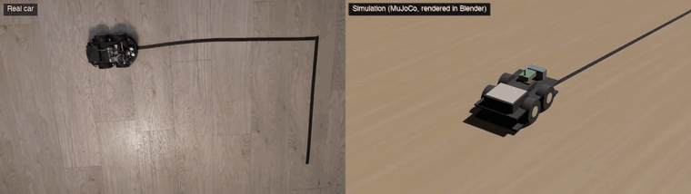
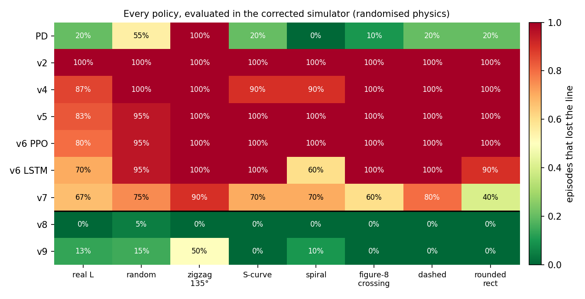
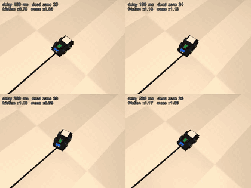
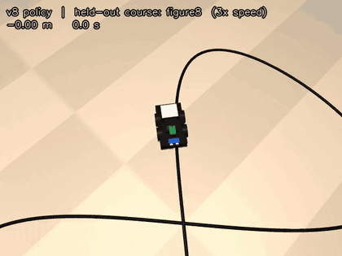
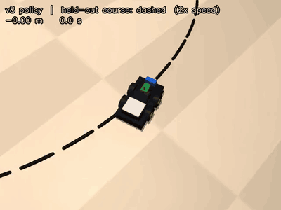
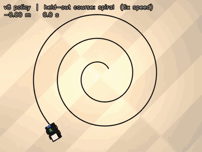
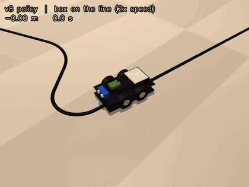
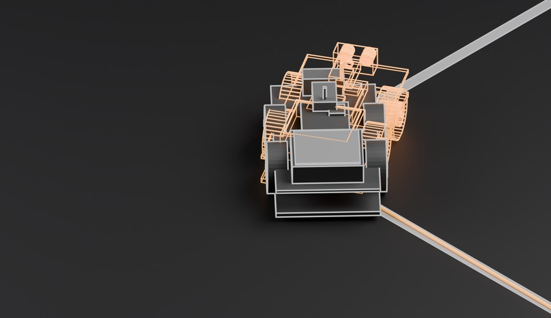
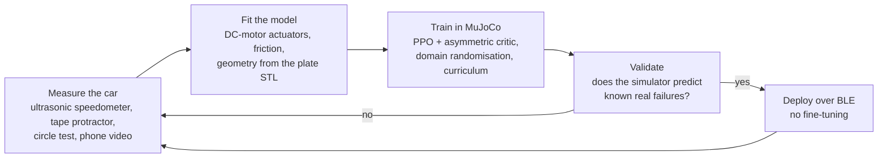
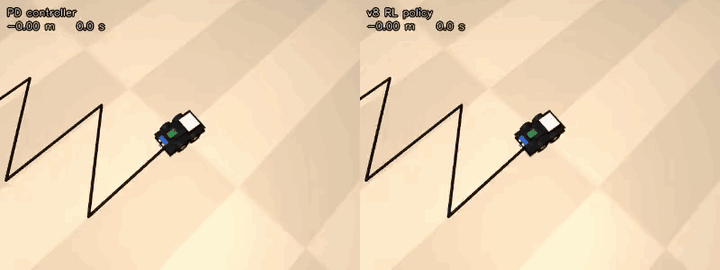

# Sim-to-Real Line Following on a $50 Robot Car



<sub>The same policy on the real car (left) and in the simulator it was trained in (right), at 2× speed.</sub>

A PPO policy trained entirely in MuJoCo that drives a real **Elegoo Smart Robot Car V4** along a taped line, with no fine-tuning on hardware. The car has three analog IR sensors, an ultrasonic sensor, no encoders and no IMU, and is controlled from a laptop over Bluetooth Low Energy.

Most of the work went into the simulator, not the learning algorithm: identifying the car with its own sensors, taking the chassis geometry from the manufacturer's CAD, and accepting a model change only when the simulator correctly predicted a failure already observed on the floor.

**Write-up:** [Sim-to-Real Is a Measurement Problem](https://airo7.me/blog/sim-to-real-robot-car.html)

## Results

The first policy trained in the corrected simulator (`v8`) completed the real L-shaped track (a 1.5 m straight, a sharp 90° turn, a 1.2 m second leg) on its first attempt:

| Real car, L track | Hand-written PD controller | v7 (earlier simulator) | **v8** |
|---|---|---|---|
| Frames with the tape under a sensor | 92% | 27% | **92%** |
| Longest interval without the tape | 0.7 s | 13.6 s | **0.7 s** |
| Centre sensor on the tape | 56% | 14% | **63%** |
| 90° corner | completed | not reached | **completed** |

Re-evaluated in the corrected simulator, every policy trained in the earlier simulators fails, and the ranking matches what happened on the real car:



The same weights handle courses and events that never appear in training:

<table>
  <tr>
    <td width="50%"><br><sub>Four cars with different randomised physics, one policy.</sub></td>
    <td width="50%"><br><sub>A figure-8 whose line crosses itself.</sub></td>
  </tr>
  <tr>
    <td><br><sub>A dashed line with 3 cm gaps.</sub></td>
    <td><br><sub>A spiral tightening to a 15 cm radius.</sub></td>
  </tr>
  <tr>
    <td colspan="2" align="center"><br><sub>A box on the line: slow, stop, resume once it is removed.</sub></td>
  </tr>
</table>

The remaining gap is a visible weave on the real car (about ±3 cm at one cycle per second). A phone-video tracker and an open-loop replay of the logged commands show that the real car turns about twice as hard as the model for the same commands. See [Known gaps](#known-gaps).

## How it works





- **Observation:** the last 8 control steps of the three IR activations, the ultrasonic range and the policy's own previous action. No pose and no line offset, because the car cannot measure them.
- **Critic:** additionally sees the true lateral error and heading, the curvature ahead and the sampled physics (asymmetric actor-critic). On the car that part of the input is zero and the actor ignores it.
- **Simulator:** analog IR spot-coverage model with saturation and floor noise, 150–300 ms command delay with dropped commands, the measured motor dead zone, and randomised motor strength, friction, mass, sensor geometry and tape width. The car's ultrasonic emergency stop runs inside the training loop, exactly where it runs on the laptop.
- **Training:** 20 M steps of PPO with 12 parallel environments, about 50 minutes on an Apple M4 Pro.

## Repository layout

```
hardware/
  arduino/main/main.ino   firmware: binary protocol, analog IR, raw-PWM command mode
  run_hardware.py         drive the real car (PD line follower, RL policy, obstacle avoider)
  pc_bridge_ble.py        BLE UART link (bleak), same interface as the serial link
  pc_bridge_serial.py     USB serial link and the gym-style hardware environment
  pc_bridge_factory.py    stock Elegoo firmware over USB or the factory ESP32's WiFi
  protocol.py             packet format, measured PWM→speed scale, shared sensor parser
  line_follower.py        PD line follower, ultrasonic guard, obstacle avoider
  ir_calib.py             fixed and self-adapting IR calibration
  record.py, motor_sweep.py, wall_test.py, turn_test.py, circle_test.py, drift_test.py
                          measurement tools (see "Measuring the car")
  video_track.py          car-frame tracking from a phone video, synchronised to a run log
mjsim/
  elegoo_v4.xml           MuJoCo model, geometry from the official plate STL files
  calibrate.py            fits motor gain, no-load speed and friction to measurements
  car_env.py              the sim-to-real environment, scenario generator and test courses
  baseline.py             the PD controller inside the simulator
  watch.py                live viewer
  watch_training.py       drives the newest checkpoint next to the learning curves during training
  export_blender.py, blender_scene.py, blender_feature.py
                          export a run and render it in Blender
rl/
  train_car.py            training (PPO, tuned PPO, LSTM), configs v3–v9, regression suite
  privileged.py           asymmetric actor-critic for Stable-Baselines3
  policy/v8_ppo/          the policy that drove the real track
analysis/
  evaluate_policies.py    every policy on identical courses, checkpoint progress
  compare_video.py        real-vs-sim weave statistics and open-loop command replay
```

## Setup

```bash
python3 -m venv .venv && source .venv/bin/activate
pip install -r requirements.txt        # requirements.lock lists the exact tested versions
```

Tested on Python 3.13, macOS, Apple Silicon. Two macOS-specific notes:

- **Bluetooth permission.** `bleak` needs Bluetooth access for the terminal application (System Settings → Privacy & Security → Bluetooth). Restart the terminal after granting it.
- **Arduino toolchain.** The AVR compiler shipped with `arduino:avr` is an x86 binary. On Apple Silicon without Rosetta, `arduino-cli` fails with `bad CPU type in executable`; install Rosetta with `softwareupdate --install-rosetta --agree-to-license`.

## Hardware

### Parts and wiring

| Part | Detail |
|---|---|
| Car | Elegoo Smart Robot Car V4: Arduino UNO R3, SmartCar shield V1.1, TB6612FNG, 4 TT motors |
| Line sensors | 3 analog IR sensors, 15 mm apart, about 103 mm ahead of the centre between the axles |
| Wireless | HM-10-style BLE UART module (sold as "HC-05"), service `FFE0`, characteristic `FFE1` |
| Track | 15 mm black tape on a light floor |

The BLE module plugs into the shield's ESP32-CAM socket (remove the ESP32-CAM first). The socket is wired to the Arduino's hardware UART and is 3.3 V-level, so no divider is needed:

| Socket | BLE module |
|---|---|
| +5V | VCC |
| GND | GND |
| TXD | RXD |
| RXD | TXD |

If no data arrives, swap TXD and RXD. The socket shares pins D0/D1 with USB, so **unplug the BLE module before flashing over USB**.

### Firmware

```bash
arduino-cli core install arduino:avr
arduino-cli compile --fqbn arduino:avr:uno hardware/arduino/main
arduino-cli upload  --fqbn arduino:avr:uno -p /dev/cu.usbmodem00001 hardware/arduino/main
```

`USE_BLUETOOTH 1` (the default) runs the link at 9600 baud over BLE or USB. The protocol, in both directions:

| Packet | Bytes | Content |
|---|---|---|
| CMD, PC → car | `AA l r mode 00 chk` | `mode 0`: velocity bytes (128 = stop). `mode 1`: raw PWM, `pwm = (byte − 128) · 2`. `chk = l ^ r ^ mode` |
| SENS, car → PC | `BB ir0 ir1 ir2 dist_hi dist_lo 00 chk` | analog IR (0–255), ultrasonic range in mm (9999 = no echo), 25 Hz |

The motors stop if no command arrives for 500 ms. On this car the IR inputs are physically swapped (A0 is the right-hand sensor); `protocol.SensReader` reorders them, so every tool and log uses physical left, centre, right.

### IR calibration

```bash
python3 -m hardware.ir_calib --calibrate      # guided: floor first, then centred on the tape
python3 -m hardware.ir_calib                  # live monitor of raw readings and activations
```

Without a saved calibration, the links fall back to a self-adapting calibration that tracks each sensor's own baseline.

## Running on the car

```bash
python3 -m hardware.ble_scan --name HC                      # find the module and its characteristics
python3 -m hardware.record --seconds 10                     # stream sensors, motors off
python3 -m hardware.run_hardware                            # PD line follower over BLE
python3 -m hardware.run_hardware --controller car_rl        # the v8 policy
python3 -m hardware.run_hardware --controller car_rl --live # with the live dashboard
python3 -m hardware.run_hardware --controller avoid         # ultrasonic-only wander
```

Pass `--address <uuid>` to skip the BLE scan. Every run is logged to `hardware/logs/run_<timestamp>.csv` (raw IR, activations, ultrasonic, packet age, commands).

## Measuring the car

Each tool measures one property of the car using only its own sensors. These measurements are what the simulator is fitted to.

| Command | Measures |
|---|---|
| `python3 -m hardware.motor_sweep` | Wheels in the air: direction and start-up PWM per side |
| `python3 -m hardware.wall_test --pwm --steps 15 20 25 30 40` | Drive at a wall: ground speed from the ultrasonic slope, reaction time, coast; dead zone |
| `python3 -m hardware.turn_test` | Spin over a straight tape: yaw rate from tape crossings, skid-steer efficiency |
| `python3 -m hardware.circle_test --pair 45 0` | Turning while driving (`--sim` prints the model's prediction) |
| `python3 -m hardware.drift_test --pwm 70` | Open-loop drift along a straight tape |
| `python3 -m hardware.video_track VIDEO --log LOG` | Offset, heading and corner position from a phone video, synchronised to the log |

Fit the drivetrain to the measurements and check the result:

```bash
python3 -m mjsim.calibrate            # writes mjsim/drivetrain.json
python3 -m mjsim.calibrate --check
```

## Simulation and training

```bash
python3 -m mjsim.watch --controller rl --track figure8 --randomize    # watch a policy
python3 -m mjsim.watch --controller pd --track L                      # the PD controller in simulation
```

Courses: `L` (the real track), `random` (the training generator), and held-out `zigzag`, `s_curve`, `spiral`, `figure8`, `dashed`, `rect`.

```bash
python3 -m rl.train_car --config v9 --algo ppo_tuned --steps 20000000 --ckpt-every 500000 --out rl/policy/v9_ppo
python3 -m mjsim.watch_training --run rl/policy/v9_ppo                 # live view while training
tensorboard --logdir rl/policy/v9_ppo/tb
python3 -m rl.train_car --suite rl/policy/v9_ppo/car_ppo.zip           # regression suite vs PD
```

| Config | Adds |
|---|---|
| `v3` | 4 frames of IR and previous action, random tracks, domain randomisation |
| `v4` | 8 frames, ultrasonic, privileged critic, scenario curriculum (hairpins, junctions, gaps, obstacles, battery sag, BLE stalls, pushes) |
| `v5` | the car's ultrasonic stop inside the training loop |
| `v7` | failure penalty 40 instead of 5, so reliability outweighs speed |
| `v8` | measured dead zone, tape and sensor geometry, saturating IR |
| `v9` | dead-zone compensation (non-zero commands start at PWM 28), applied identically on the car |

Every training run writes `env_config.json` and `algo.json` next to its policies; evaluation, the viewer and the car controller rebuild the exact observation layout and load recurrent policies from them.

### Reproducing the analysis

```bash
python3 -m analysis.evaluate_policies --policies v8=rl/policy/v8_ppo/car_ppo.zip
python3 -m analysis.evaluate_policies --checkpoints rl/policy/v8_ppo
python3 -m analysis.compare_video --log LOG --track VIDEO.track.csv --model rl/policy/v9_ppo/car_ppo.zip
```

### Rendering

```bash
python3 -m mjsim.export_blender --controller rl --track L --seconds 30    # run JSON + quick MuJoCo preview
blender --background --python mjsim/blender_scene.py -- runs/L_rl.json runs/L.mp4 [--cycles]
blender --background --python mjsim/blender_feature.py -- runs/L_rl.json feature.png 238
```

## Known gaps

- **Turning with one wheel stopped** is about 8× stronger on the real car than in the model (0.52 vs 0.07 rad/s at PWM 45 / 0); the current model structure cannot express it. Dead-zone compensation (`v9`) avoids the regime but changes the corner behaviour.
- **The real car turns about twice as hard** as the model for the same commands, and drifts right at higher speed. Left/right *speed* asymmetry is not yet randomised (only torque is).
- **Hairpins:** on 135° turns the policy keeps the line but stalls. The PD controller (left) gets further before losing the line:

  

- Real-car evidence is a single track and a handful of runs per policy; simulated evaluations use 10–30 episodes per condition.

## References

- Todorov, Erez & Tassa (2012). MuJoCo: A physics engine for model-based control.
- Schulman et al. (2017). Proximal Policy Optimization Algorithms.
- Tobin et al. (2017). Domain Randomization for Transferring Deep Neural Networks from Simulation to the Real World.
- Peng et al. (2018). Sim-to-Real Transfer of Robotic Control with Dynamics Randomization.
- Pinto et al. (2018). Asymmetric Actor Critic for Image-Based Robot Learning.
- [ELEGOO Smart Robot Car Kit V4.0](https://github.com/elegooofficial/ELEGOO-Smart-Robot-Car-Kit-V4.0), including the chassis STL files.

## License

[MIT](LICENSE)
